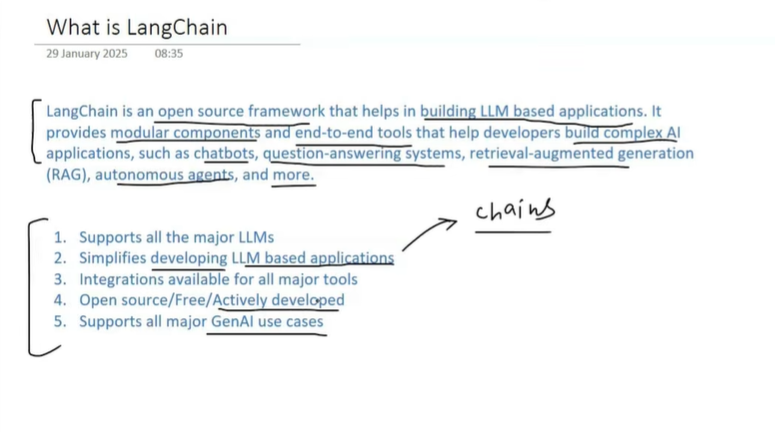
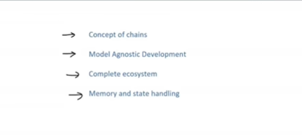
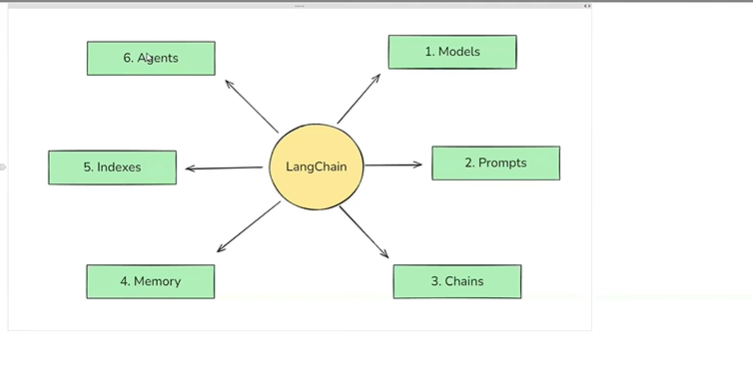
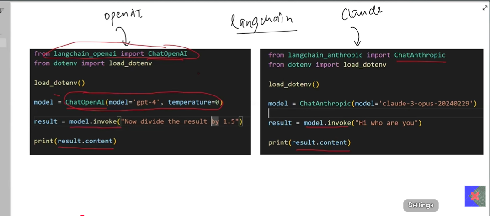
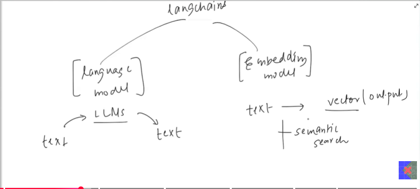
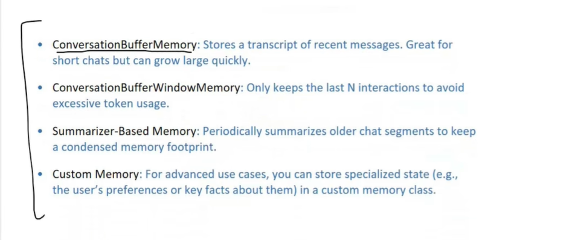
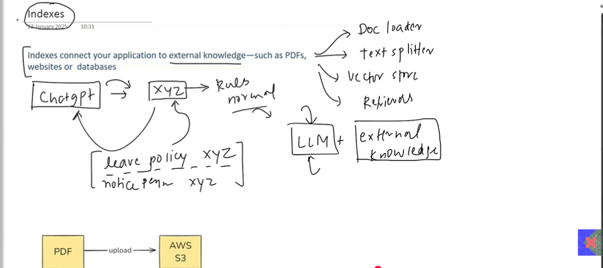
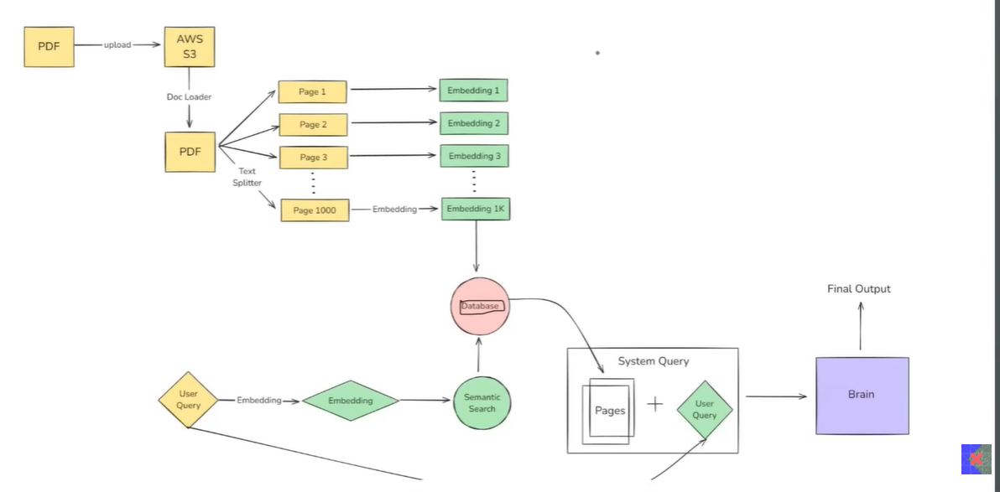

# Building Basic LLM Apps (08-building-basic-llm-apps.md)

> Reference: YouTube Lecture Series by Nitish Singh (CampusX)
> Perspective: The User's Perspective (41:37)
> Slide Box: Building Basic LLM Apps (Green (Full Left Column))

## Table of Contents
* Open Source vs Closed Source LLMs
* Using LLM APIs
* LangChain
* HuggingFace
* Ollama

---

## Building Basic LLM Apps: The 5 Core Building Blocks

## 8. Building Basic LLM Apps

> 📸 **Slide Reference**: *The User's Perspective* (41:37 / 50:14) · **Green Box (Full Left Column)**

This box shows the **5 essential tools and choices** when you start building AI applications:

1. **Open Source vs Closed Source LLMs**
   * **Closed Source** *(GPT, Gemini, Claude)*: Easy to start, top quality, accessed via API, pay per use.
   * **Open Source** *(Llama, Mistral, Gemma)*: Free to download, keeps data private on your own servers/laptop.
2. **Using LLM APIs**
   * Your code sends a prompt + API key to a provider and gets a smart text response back in JSON.
3. **LangChain**
   * A developer framework that makes it much easier to connect prompts, LLMs, documents, and tools into one workflow.
4. **HuggingFace**
   * The central hub where developers share open-source models, datasets, and demos.
5. **Ollama**
   * A lightweight tool for running open-source LLMs locally on your own computer.

### Self-Check Questions
#### Q1: What is the simple difference between Closed Source and Open Source LLMs?
**Answer:** Closed Source LLMs (like ChatGPT/Gemini) run on the provider’s servers and are super easy to call via API, while Open Source LLMs can be downloaded and hosted on your own hardware for privacy and full control.

#### Q2: Why do beginners use Ollama?
**Answer:** Ollama makes running open-source models like Llama on a personal computer as easy as running a single terminal command, with zero complex setup.

---

## LangChain: What is LangChain & Benefits

*About this slide:* This slide defines LangChain as a free, open-source framework with modular components ("chains") and tool integrations that make it simple to build chatbots, Q&A systems, RAG, and AI agents using any major LLM.

*About this slide:* This slide lists the 4 core reasons developers use LangChain: connecting steps through chains, writing model-agnostic code across LLMs, getting a complete ecosystem of tools, and handling chat memory and state.
## What is LangChain

> 📸 **Slide Reference**: User's Perspective → **LangChain** (*29 January 2025 · 08:35*)

### Definition (From Slide)
**LangChain** is an **open source framework** that helps in **building LLM based applications**. It provides **modular components** and **end-to-end tools** that help developers **build complex AI applications**, such as:
* **Chatbots**
* **Question-answering systems**
* **Retrieval-Augmented Generation (RAG)**
* **Autonomous agents**, and more

---

### 5 Key Highlights (From Slide)
1. **Supports all the major LLMs**
2. **Simplifies developing LLM based applications** → connects steps using **chains**
3. **Integrations available for all major tools**
4. **Open source / Free / Actively developed**
5. **Supports all major GenAI use cases**

---

### Benefits of LangChain (From Slide)
1. **Concept of chains**
   * Lets you connect multiple steps (e.g., *Prompt → LLM → Output*) into one clean pipeline instead of writing messy manual code.
2. **Model Agnostic Development**
   * Your app is not locked into one provider—you can switch between GPT, Gemini, Claude, or local Ollama models with minimal changes.
3. **Complete ecosystem**
   * Gives you built-in building blocks for document loaders, text splitters, vector databases, prompts, and APIs all in one place.
4. **Memory and state handling**
   * Easily remembers previous messages and keeps track of conversation state, which is essential for chatbots and multi-step agents.

### Self-Check Questions
#### Q1: What is LangChain in simple words?
**Answer:** LangChain is a free, open-source framework that provides ready-made components and tools ("chains") to build LLM apps like chatbots, Q&A systems, RAG, and autonomous agents.

#### Q2: What are the 4 main benefits of using LangChain?
**Answer:** 1. Concept of chains (connecting multi-step workflows), 2. Model Agnostic Development (easy to swap LLMs), 3. Complete ecosystem (loaders, vector DBs, tools), and 4. Memory and state handling (keeping chat history and workflow state).

---

## LangChain: 6 Components, LangServe & LangSmith

## Components of LangChain

*About this slide:* This diagram maps the 6 core building blocks of LangChain—**1. Models, 2. Prompts, 3. Chains, 4. Memory, 5. Indexes, and 6. Agents**—all organized around the LangChain framework.

---

### 1. Models
**Models** are the **core interface through which you interact with AI models**. Instead of learning a completely different SDK for every AI company, LangChain gives you one standard way to call them.

*About this slide:* Notice how switching from **OpenAI** (`ChatOpenAI`) to **Claude** (`ChatAnthropic`) keeps almost the exact same code—`model.invoke(...)` and `result.content` do not change.

*About this slide:* Under LangChain, Models are split into **2 types**: **Language Models (LLMs)** that turn *text → text*, and **Embedding Models** that turn *text → vector* for semantic search.

* **Language Models (LLMs)**: Input is **text** → Output is **text** (used for chatbots, writing, summarizing, Q&A).
* **Embedding Models**: Input is **text** → Output is a **vector** (used for **semantic search** and finding similar documents).

---

### 2. Prompts
Prompts are the instructions you send to a Model. LangChain provides reusable **Prompt Templates** with variables (like `{topic}` or `{language}`) so you can fill in user inputs cleanly without rewriting prompts manually.

---

### 3. Chains
A **Chain** connects multiple LangChain components together in sequence so the output of one step automatically flows into the next step.
* **Example**: `Prompt Template → Language Model → Output Parser`
* **Why It Helps**: Instead of writing separate glue code for every step, you build one clean pipeline and run it with a single `.invoke()` call (and you can also connect sequential, parallel, or conditional branches).

---

### 4. Memory
We need **Memory** when we want to **design a Chatbot**.
* Normally, every time you call an LLM API, it treats your message as brand new and **forgets everything you said earlier**.
* If we want an LLM to behave like a real Chatbot, it needs to know the **previous chat history**—and that is exactly what **Memory** stores and passes back to the model.

*About this slide:* This slide shows the 4 ways LangChain stores conversation history depending on chat length and token budget—**ConversationBufferMemory**, **ConversationBufferWindowMemory**, **Summarizer-Based Memory**, and **Custom Memory**.

* **ConversationBufferMemory**: Stores a transcript of recent messages. Great for short chats, but can grow large quickly.
* **ConversationBufferWindowMemory**: Only keeps the last **N** interactions to avoid excessive token usage.
* **Summarizer-Based Memory**: Periodically summarizes older chat segments to keep a condensed memory footprint.
* **Custom Memory**: For advanced use cases, lets you store specialized state (e.g., the user's preferences or key facts about them) in a custom memory class.

---

### 5. Indexes
**Indexes** connect your application to **external knowledge**—such as PDFs, websites, or databases (for example, your company's internal leave policy or notice period rules that ChatGPT doesn't know).

*About this slide:* This diagram shows why an LLM needs external knowledge (like XYZ company's leave policy and notice period) and lists the 4 parts of Indexes: **Doc Loader, Text Splitter, Vector Store, and Retrievers**.

The 4 building blocks inside Indexes:
1. **Doc Loader**: Reads files from PDFs, AWS S3, websites, or databases.
2. **Text Splitter**: Breaks big documents into smaller chunks/pages.
3. **Vector Store**: Saves the vector embeddings in a searchable database.
4. **Retrievers**: Searches the vector store and fetches the most relevant chunks for the LLM.

---

### 6. Agents
**AI Agents** are a **combination of LLM and code**. Unlike a basic chatbot that only replies with text, an Agent can think, act, and use tools:
* **External Tools**: Can access external apps like **Google Search**, **Python REPL** (running code), calculators, or APIs.
* **Task Breakdown & Reasoning**: Can reason through a goal and divide complex tasks into smaller, simpler steps.
* **Self-Reflection**: Can review and double-check its own answer before replying to the user.
* **Collaboration & Debate**: Multiple agents can collaborate on a series of tasks—and even debate with each other to reach a better answer.
* **LangGraph**: LangChain supports building advanced, stateful AI Agents and multi-agent workflows using **LangGraph** (where steps, loops, and decisions are modeled as a graph).

---

### Beyond the 6 Components: LangServe & LangSmith
Apart from the 6 core components above, LangChain also built **2 important platform tools**:

1. **LangServe**
   * Helps you **deploy** your LangChain chains/apps as **ready-to-use REST APIs** (built on FastAPI).
   * Automatically gives your chain endpoints like `/invoke` and `/stream` plus a built-in web playground so frontends or other apps can call your AI easily.
2. **LangSmith**
   * A **debugging, testing, and monitoring** platform for LLM apps.
   * Lets you trace every single step inside a chain or agent, inspect the exact prompts/responses, track token costs and latency, and test whether your app's answers stay accurate.

### Self-Check Questions
#### Q1: What are the 2 types of Models in LangChain and how are they different?
**Answer:** Language Models (LLMs) take text in and return text out (for chatting, summarizing, Q&A). Embedding Models take text in and return a number vector out (used for semantic search and similarity matching).

#### Q2: Why do we need Memory in a LangChain chatbot?
**Answer:** Standard LLM calls do not remember previous messages. Memory saves the previous chat history and passes it along with the new question so the LLM can hold a continuous conversation.

#### Q3: What is the difference between LangServe and LangSmith?
**Answer:** LangServe helps you deploy LangChain chains as REST APIs for your app or frontend, while LangSmith is used during development and production to trace, debug, evaluate, and monitor LLM responses and costs.

---

## How Semantic Search Works

*About this slide:* This diagram shows two connected flows: the top flow uploads a PDF to AWS S3, splits it into pages (Page 1 to 1000), converts each page into Embeddings, and stores them in a Database; the bottom flow turns a User Query into an Embedding, runs Semantic Search to pull relevant pages, combines Pages + User Query into a System Query, and sends it to the Brain (LLM) for the Final Output.
## How Semantic Search Works

> 📸 **Slide Reference**: User's Perspective → **LangChain** (*Semantic Search Flow Diagram*)

### Part 1: Storing Your PDF (Top Flow in Diagram)
1. **PDF → AWS S3**: Upload your PDF file to cloud storage (**AWS S3**).
2. **Doc Loader**: Loads the **PDF** from AWS S3 into your application.
3. **Text Splitter**: Splits the large PDF into smaller pages (**Page 1, Page 2, Page 3 ... Page 1000**).
4. **Embeddings**: Each page is turned into an **Embedding** (**Embedding 1, Embedding 2, Embedding 3 ... Embedding 1K**) so its meaning can be compared mathematically.
5. **Database**: All embeddings are stored inside a **Database**.

---

### Part 2: Answering a Question (Bottom Flow in Diagram)
1. **User Query → Embedding**: The user's question is converted into an **Embedding**.
2. **Semantic Search**: Compares the query Embedding against the **Database** to find the most relevant **Pages** by meaning.
3. **System Query**: Bundles the retrieved **Pages + User Query** together into a **System Query**.
4. **Brain → Final Output**: The **Brain** (the LLM) reads the System Query and produces the **Final Output**.

### Self-Check Questions
#### Q1: Why do we split a PDF into pages and create Embeddings instead of sending the whole 1,000-page PDF to the Brain (LLM)?
**Answer:** A 1,000-page PDF is too large and slow to send every time. Splitting it into pages and storing their Embeddings lets Semantic Search quickly pull only the few matching pages for the System Query.

#### Q2: What goes inside the System Query sent to the Brain?
**Answer:** The System Query combines two things: the relevant Pages retrieved from the Database via Semantic Search + the original User Query.

